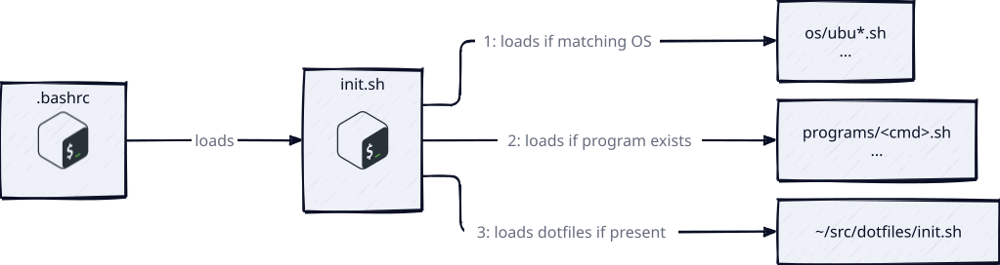
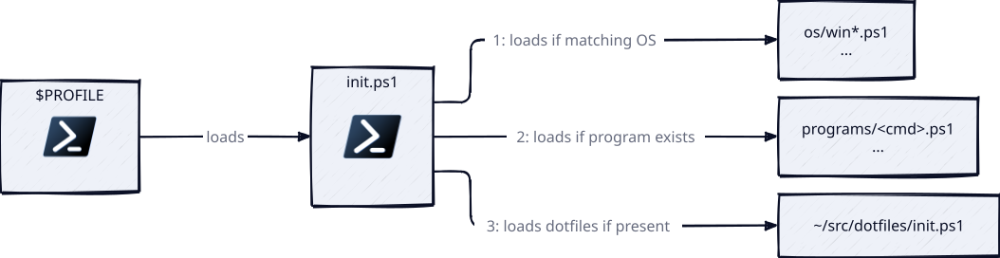

# shell-profile-helpers

`shell-profile-helpers` is a cross-shell library for organizing Bash/Zsh and PowerShell profile helpers. It loads OS-specific and installed-program modules across `os/` and `programs/` via [`init.sh`](init.sh) in `.bashrc`/`.zshrc` and [`init.ps1`](init.ps1) in PowerShell `$PROFILE`, and supports local Git clones, Bash/Zsh plugin managers (Sheldon, Oh My Bash), and a standalone setup/runner GUI (`shell-profile-helpers.exe`).

**From Bash / Zsh:**



**From PowerShell:**



## Ubuntu / Bash / Zsh Setup

Clone and register in `.bashrc` (or `.zshrc`):

```bash
git clone https://github.com/alanlivio/shell-profile-helpers.git ~/src/shell-profile-helpers
~/src/shell-profile-helpers/install.sh
```

## Windows / PowerShell Setup

If WinGet or Git is not installed, you may use [`install-winget.ps1`](install-winget.ps1) and [`install-git.ps1`](install-git.ps1), or download [`shell-profile-helpers.exe`](https://github.com/alanlivio/shell-profile-helpers/releases/latest/download/shell-profile-helpers.exe).

Clone and register in `$PROFILE`:

```powershell
git clone https://github.com/alanlivio/shell-profile-helpers.git ~\src\shell-profile-helpers
& ~\src\shell-profile-helpers\install.ps1
```

## `dotfiles` Integration

`shell-profile-helpers` is designed to pair with a personal and private `dotfiles` repository located at `~/src/dotfiles`.

`shell-profile-helpers` automatically loads `~/src/dotfiles/init.sh` or `~/src/dotfiles/init.ps1` at the end of initialization so personal `dotfiles` can immediately use loaded helpers and override `my_*` lifecycle functions.

## `my_*` Helpers

`shell-profile-helpers` provides baseline implementations for common lifecycle helpers in [`os/ubu.sh`](os/ubu.sh) and [`os/win.ps1`](os/win.ps1):

- `my_declutter`: Removes unused packages/shortcuts and hides dotfiles in the user home directory.
- `my_software`: Installs software and upgrades system packages (`winget upgrade` on Windows, `apt update && apt upgrade` on Ubuntu).
- `my_dotfiles`: Pulls Git updates for the `dotfiles` repository.

## References

This project takes inspiration from:

- <https://github.com/Bash-it/bash-it>
- <https://github.com/milianw/shell-helpers>
- <https://github.com/wd5gnr/bashrc>
- <https://github.com/martinburger/bash-common-helpers>
- <https://github.com/jonathantneal/git-bash-helpers>
- <https://github.com/donnemartin/dev-setup>
- <https://github.com/aspiers/shell-env>
- <https://github.com/nafigator/bash-helpers>
- <https://github.com/TiSiE/BASH.helpers>
- <https://github.com/midwire/bash.env>
- <https://github.com/e-picas/bash-library>
- <https://github.com/awesome-windows11/windows11>
- <https://github.com/99natmar99/Windows-11-Fixer>
- <https://github.com/W4RH4WK/Debloat-windows-10/tree/master/scripts>
