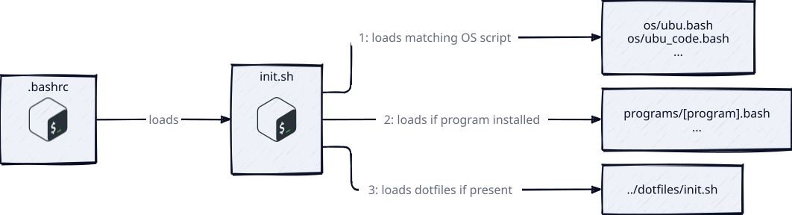
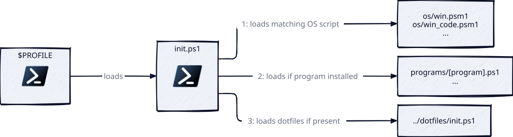

# cli-helpers

`cli-helpers` is a library for organizing your Bash and PowerShell helper scripts. It automatically loads scripts from the `os/` directory based on your current operating system, and from the `programs/` directory if a specific program is installed. To use the library, you need to load [`init.sh`](init.sh) in your `.bashrc` and [`init.ps1`](init.ps1) in your PowerShell `$PROFILE`. The diagrams below provide an overview of the library's behavior.

**From Bash:**



**From PowerShell:**



## Ubuntu Setup

You can use the Bash commands below to fetch, install, and set up `cli-helpers` to be loaded in your `.bashrc`:

```bash
git clone https://github.com/alanlivio/cli-helpers ~/src/cli-helpers
. ~/src/cli-helpers/setup_profile.sh
```

## Windows Setup

If WinGet or Git is not installed, you may use  [`install-winget.ps1`](install-winget.ps1) and  [`install-git.ps1`](install-git.ps1), or download the [`cli-helpers` GUI](https://github.com/alanlivio/cli-helpers/releases/latest/download/cli-helpers.exe).

To set up `cli-helpers` to be loaded in your `profile.ps1` by calling [`setup_profile.ps1`](setup_profile.ps1):

```powershell
git clone https://github.com/alanlivio/cli-helpers ~\src\cli-helpers
& ~\src\cli-helpers\setup_profile.ps1
```

## `dotfiles` Integration

`cli-helpers` is designed to be paired with a personal and private dotfiles repository located at the same directory level (for example, `~/src/dotfiles` alongside `~/src/cli-helpers`).

`cli-helpers` automatically loads the companion dotfiles repository via `dotfiles/init.sh` or `dotfiles/init.ps1` at the end of its initialization. This allows personal dotfiles to immediately use loaded helpers and override `my_*` lifecycle helpers without needing to manually import `cli-helpers`.

## `my_*` Helpers

`cli-helpers` provides baseline implementations for common lifecycle helpers in [`os/ubu.bash`](os/ubu.bash) and [`os/win.psm1`](os/win.psm1):

- `my_declutter`: Removes unused packages/shortcuts and hides dotfiles in the user home directory.
- `my_software`: Installs software Python, and upgrades system packages (`winget upgrade` on Windows, `apt update && apt upgrade` on Ubuntu).
- `my_dotfiles`: Pulls git updates for the dotfiles repository.

## References

This project takes inspiration from:

- <https://github.com/Bash-it/bash-it>
- <https://github.com/milianw/shell-helpers>
- <https://github.com/wd5gnr/bashrc>
- <https://github.com/martinburger/bash-common-helpers>
- <https://github.com/jonathantneal/git-bash-helpers>
- <https://github.com/donnemartin/dev-setup>
- <https://github.com/aspiers/shell-env>
- <https://github.com/nafigator/bash-helpers>
- <https://github.com/TiSiE/BASH.helpers>
- <https://github.com/midwire/bash.env>
- <https://github.com/e-picas/bash-library>
- <https://github.com/awesome-windows11/windows11>
- <https://github.com/99natmar99/Windows-11-Fixer>
- <https://github.com/W4RH4WK/Debloat-windows-10/tree/master/scripts>
